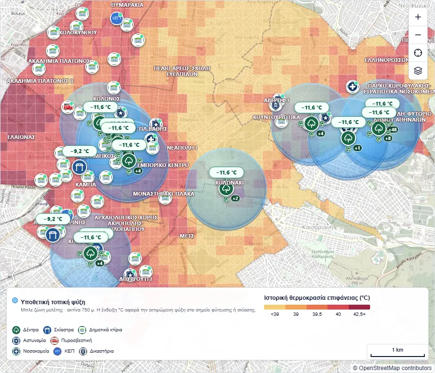

# AthensShade Ai

**Με 150.000 €, πού αξίζει να φυτέψει δέντρα και να βάλει σκίαστρα ο Δήμος Αθηναίων;**

Το AthensShade μετατρέπει τον προϋπολογισμό του Δήμου σε πλάνο σκίασης για τις πιο ζεστές περιοχές της Αθήνας. Για κάθε θέση δείχνει τι προτείνεται, πόσο κοστίζει και πόση σκιά εκτιμάται ότι θα προσφέρει.

**Παράδειγμα από την εφαρμογή.** Με προϋπολογισμό 150.000 €, το ισορροπημένο πλάνο πρότεινε **95 δέντρα και 3 σκίαστρα** με εκτιμώμενο κόστος **149.915,54 €**.

## Δοκιμάστε το σε ένα λεπτό

1. Επιλέξτε ένα κόκκινο κελί για να δείτε την ιστορική θερμοκρασία της επιφάνειας.
2. Βάλτε **150.000 €** και πατήστε **«Υπολόγισε πλάνο»**. Ανοίξτε ένα δέντρο ή σκίαστρο για να δείτε την ποσότητα, το κόστος και την εκτιμώμενη σκιά σε m². Αλλάξτε το ποσό για να συγκρίνετε τα πλάνα.
3. Πατήστε **«Αντίκτυπος στον χάρτη»**. Οι μπλε κύκλοι ορίζουν ζώνες μελέτης γύρω από τις φυτεύσεις. Η ένδειξη °C αφορά την εκτιμώμενη ψύξη του δαπέδου στο σημείο που θα σκιαστεί.

*Χαρτογραφικό υπόβαθρο © [OpenStreetMap contributors](https://www.openstreetmap.org/copyright).*

## Πώς επιλέγονται οι θέσεις

Η εφαρμογή συνδυάζει θερμικά δεδομένα, δενδροκάλυψη και χαρτογραφημένους χώρους πεζών. Ο αλγόριθμος επιλέγει συνδυασμό παρεμβάσεων εντός προϋπολογισμού. Το τοπικό μοντέλο AI βοηθά να εξηγηθεί η πρόταση και τι χρειάζεται έλεγχο στην αυτοψία. Για δημόσια κτίρια εμφανίζονται επίσης δυνατότητες όπως φυτεμένα δώματα.

**Apps4Athens 3.0 Gov Hackathon** · [Τοπική εκκίνηση και τεχνικός οδηγός](docs/technical-guide.md) · [Πηγές δεδομένων](data/README.md) · [Οικονομικές παραδοχές](docs/business-case.md)
